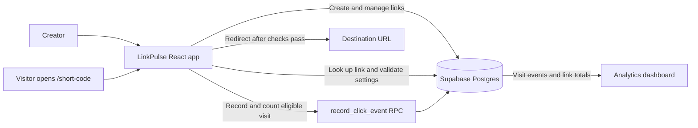

# LinkPulse

> Turn long URLs into memorable, controlled, and measurable links.

LinkPulse is a URL-shortening and link-analytics web app built by **Team Tech Titans**. Create a short link, choose how it can be used, share it with a QR code, and follow its traffic from one workspace.

## Contents

- [What LinkPulse does](#what-linkpulse-does)
- [What makes it stand out](#what-makes-it-stand-out)
- [How it works](#how-it-works)
- [Tech stack](#tech-stack)
- [Run locally](#run-locally)
- [Build and lint](#build-and-lint)
- [Deploy to Vercel](#deploy-to-vercel)
- [Current scope and security notes](#current-scope-and-security-notes)
- [Project structure](#project-structure)

## The problem

Long URLs are awkward to share, and a plain redirect gives little control or insight. LinkPulse combines short, memorable URLs with practical link limits and a dashboard that helps explain the traffic they receive.

## What LinkPulse does

- **Creates shareable short links.** Use a generated short code or choose a custom alias. Destinations must be valid HTTP or HTTPS URLs.
- **Adds link controls.** Set an expiry date, a maximum click count, or a one-time-use limit. Links can also be disabled or deleted from the workspace.
- **Offers a password gate.** Set a passphrase when creating a link; visitors must enter it before continuing.
- **Tracks traffic quality.** LinkPulse records visits and device type, and classifies known crawler/social-preview and browser-automation signals separately from rapid repeat visits ("ghost" clicks).
- **Shows analytics.** Review counted visits, device mix, and a seven-day activity chart, with bot/preview and ghost traffic shown separately. Analytics refresh periodically while the page is open.
- **Makes sharing easier.** Copy a short link or download its QR code as a PNG.
- **Keeps links manageable.** Search and review your links, check their status and click limits, and turn links on or off.
- **Adapts to your preference.** Use the responsive interface in light or dark mode; the theme choice is remembered in the browser.

## What makes it stand out

- **Controls and analytics work together.** Expiry, password prompts, link status, and click limits are part of the same link-creation and redirect flow.
- **Click limits are counted atomically.** The PostgreSQL `record_click_event` function locks the link row while checking and incrementing the counter, preventing two simultaneous qualifying visits from both consuming the same final click.
- **Traffic categories stay visible.** Visits classified as bots/previews or rapid repeats are recorded separately, so they do not inflate the counted-click metric.
- **The sharing experience is complete.** A generated link can be copied or shared as a downloadable QR code straight from the success dialog.
- **The interface is built for a live demo.** The animated, glass-inspired design, responsive layout, live preview, and dashboard make the link workflow easy to present.

## How it works



Short links use the current site origin and the short code as a path, for example `https://your-site.example/my-alias`. On Vercel, the SPA rewrite sends that path to the React app, which looks up the link and runs the redirect flow.

## Data model

- **`links`** stores each destination, short code, expiry and click limits, disabled status, browser visitor ID, and optional password hash.
- **`clicks`** stores visit events such as timestamp, device type, source, traffic classification, bot/ghost flags, and whether the visit counted.
- **`record_click_event`** checks a link and records eligible events in a PostgreSQL transaction.

## Tech stack

- **Frontend:** React 19, Vite 8, Tailwind CSS 4, custom CSS, and Lucide icons
- **Backend and data:** Supabase Postgres, the Supabase JavaScript client, Row Level Security policies, and a PostgreSQL RPC for click recording
- **QR codes:** `qrcode` package
- **Hosting:** Vercel configuration is included in `frontend/vercel.json`

## Run locally

### Requirements

- Node.js **20.19+ in the 20.x line**, or **22.12+**
- npm
- Git, if you are cloning the repository

No Supabase setup is needed to run the included demo. You need your own Supabase project only if you want to replace its configured backend.

The Vite app is inside `frontend`, so run the commands there:

```bash
cd frontend
npm install
```

The repository includes `frontend/.env` with the demo Supabase project URL and its public `anon` key, so the demo runs without copying a file or entering credentials. Vite loads this file automatically. The same public configuration is included in the deployed frontend; judges only need the demo URL to try the hosted site.

To connect a separate Supabase project, create `frontend/.env.local` with that project's URL and public key. Vite loads `.env.local` for local development, and Git ignores it:

```dotenv
VITE_SUPABASE_URL=your_supabase_project_url
VITE_SUPABASE_ANON_KEY=your_supabase_anon_or_publishable_key
```

### Prepare the database

For a **new Supabase project**, open its SQL Editor and run the full [`supabase_migration.sql`](supabase_migration.sql) file. It creates or updates the `links` and `clicks` tables, indexes, policies, and `record_click_event` function. If your team is using the already-configured shared project and the migration has been applied, do not run it again just for local development.

### Start the app

From the `frontend` directory:

```bash
npm run dev
```

Open the local URL printed by Vite, usually `http://localhost:5173`. Local links use the local origin, so they are for local testing; use the deployed site when you need links that other people can open.

## Build and lint

Run these from `frontend`:

```bash
npm run lint
npm run build
npm run preview
```

`npm run preview` serves the production build locally after `npm run build` completes.

## Deploy to Vercel

1. Import the repository into Vercel.
2. Set **Root Directory** to `frontend`.
3. Use the Vite framework preset, `npm install` for install, `npm run build` for build, and `dist` for output.
4. The checked-in `frontend/.env` supplies the demo project's public settings during the build, so no extra Vercel variables are required for this demo. For a different Supabase project, set `VITE_SUPABASE_URL` and `VITE_SUPABASE_ANON_KEY` in Vercel instead.
5. Confirm the Supabase migration has been run for the project used by the deployment.

`frontend/vercel.json` rewrites short-code paths to the SPA so routes such as `/my-alias` can be resolved by LinkPulse. Create shareable links from the deployed domain, not from localhost.

## Current scope and security notes

LinkPulse is a **no-sign-up hackathon/demo MVP**, not a production access-control system. The checked-in `.env` contains only the Supabase project URL and public `anon` key. Supabase expects this key to be used in browser apps; it is not a secret. The current migration allows broad anonymous access, however, so anyone with the public app or key can access and change demo data. Keep private or sensitive information out of this project. See [Supabase's API key guidance](https://supabase.com/docs/guides/database/secure-data) for the distinction between public anon keys and secret service-role keys.

The browser creates a visitor ID in `localStorage` to filter the links shown in that browser. This ID is not an authenticated identity, and another browser or device will have a different workspace view.

The current SQL migration permits broad anonymous access for the demo workflow. Row Level Security is enabled, but the policies do not provide private, per-user ownership; a visitor ID filter in the UI is not a security boundary. Passwords are SHA-256 hashed in the browser, but the hash is stored in a table that anonymous clients can read, so the password gate is not suitable for confidential links. Bot and automation detection also run in the browser and can be bypassed. Do not use this setup for private or sensitive data as-is.

Before production use, add Supabase Auth with restrictive per-user RLS policies, move sensitive redirect/password decisions to a trusted server or Edge Function, and review rate limiting and abuse controls. Never put a Supabase service-role key in a `VITE_` variable or frontend code. Social-preview crawlers that do not execute the SPA also require server-side handling to be detected reliably.

## Project structure

```text
frontend/
|-- src/
|   |-- components/       # Hero, shortener, analytics, QR dialog, and page sections
|   |-- hooks/            # Theme and link/database workflows
|   |-- assets/           # Brand logos
|   |-- App.jsx
|   `-- supabase.js       # Supabase client configuration
|-- public/               # Favicon and static assets
|-- package.json
`-- vercel.json           # SPA route rewrite
supabase_migration.sql    # Tables, policies, indexes, click RPC
```

---

**Built by Team Tech Titans**
